  <a href="https://www.youtube.com/@Nostalgia_Realm">YouTube</a> ·
  <a href="https://twitch.tv/nostalgia_realm">Twitch</a> ·
  <a href="https://ko-fi.com/nostalgiarealm">Ko-fi</a> ·
  <a href="https://discord.gg/TYWdGUGChB">Discord</a>

<!--
Card maintenance
- Text lives in data/profile.json; edit and push, the workflow re-renders.
- .github/workflows/update-card.yml refreshes stats daily (GitHub GraphQL + REST).
- Optional repo secrets: YOUTUBE_API_KEY (live channel stats), PROFILE_TOKEN (PAT, counts private commits).
- Local render: GH_TOKEN=$(gh auth token) python3 scripts/generate_card.py   (OFFLINE=1 to skip network)
- ASCII CRT is built once from assets/logo-crt.png: python3 scripts/build_ascii.py assets/logo-crt.png 64  (needs Pillow)
- Font: VT323 (SIL OFL 1.1), subset in assets/fonts/.
-->
